# Damacana Aktarma Otomasyonu

Ev tipi su arıtma cihazının (RO) basınçlı tankında biriken suyu, **pompa kullanmadan**, belirli aralıklarla otomatik olarak damacanaya aktaran basit bir sistem. Damacana dolduğu an temassız bir sensör vanayı kapatır, su taşmaz.

İki sürümü var:

| | Akıllı priz sürümü | Arduino sürümü |
|---|---|---|
| Zamanlayıcı | Wi-Fi akıllı priz | Arduino Nano |
| Kod yazmak gerekir mi? | Hayır | Hazır kod var, sadece yüklenir |
| Telefondan kontrol | Var | Yok |
| Damacana dolunca uyarı | Yok | Buzzer ile var |
| Tahmini maliyet | 1.100–2.250 ₺ | 980–2.010 ₺ |

> **Canlı tasarım sayfası:** [`docs/index.html`](docs/index.html) dosyasını indirip tarayıcıda açarsan animasyonlu simülasyonu, devre şemalarını ve hesap tablolarını görürsün. Arduino sürümü aynı sayfanın ikinci sekmesinde.

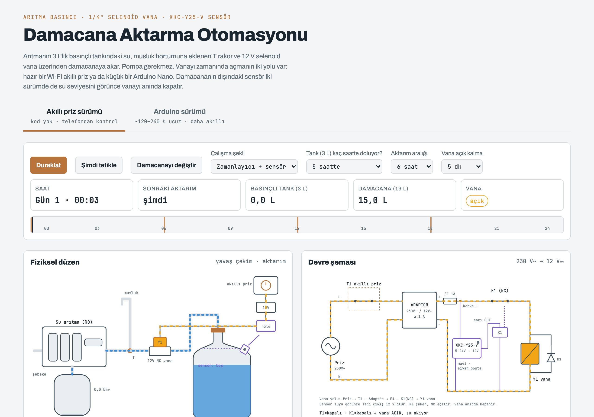

---

## İçindekiler

1. [Nasıl çalışır?](#1-nasıl-çalışır)
2. [Hangi sürümü seçmeliyim?](#2-hangi-sürümü-seçmeliyim)
3. [Malzeme listesi](#3-malzeme-listesi)
4. [Gerekli aletler](#4-gerekli-aletler)
5. [Adım 1 – Tesisat bağlantısı](#5-adım-1--tesisat-bağlantısı)
6. [Adım 2 – Damacana sensörü](#6-adım-2--damacana-sensörü)
7. [Adım 3A – Akıllı priz sürümü](#7-adım-3a--akıllı-priz-sürümü)
8. [Adım 3B – Arduino sürümü](#8-adım-3b--arduino-sürümü)
9. [Arduino'yu Mac'e bağlama ve kodu yükleme](#9-arduinoyu-mace-bağlama-ve-kodu-yükleme)
10. [Ayarlar: günde kaç kez aktarım?](#10-ayarlar-günde-kaç-kez-aktarım)
11. [İlk çalıştırma ve test](#11-ilk-çalıştırma-ve-test)
12. [Sorun giderme](#12-sorun-giderme)
13. [Güvenlik](#13-güvenlik)
14. [Dosyalar](#14-dosyalar)

---

## 1. Nasıl çalışır?

Arıtma cihazı ürettiği suyu 3 litrelik **basınçlı bir tankta** biriktirir. Tank dolunca cihaz kendiliğinden durur. Musluğu açınca tanktaki basınç suyu dışarı iter. Bu yüzden suyu taşımak için **pompaya gerek yok**, bir vananın açılması yeterli.

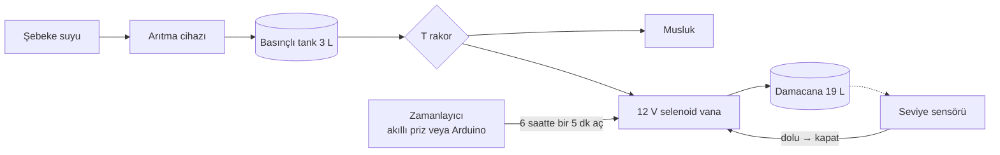

1. Musluğa giden hortuma bir **T rakor** takılır. Musluk eskisi gibi çalışmaya devam eder.
2. T'nin boşta kalan ucuna **elektrikli bir vana** (selenoid vana) bağlanır. Vanadan çıkan hortum damacananın içine gider.
3. Vana normalde **kapalıdır**. Zamanlayıcı ona elektrik verince açılır, tanktaki su damacanaya akar.
4. Damacananın dışına yapıştırılan **temassız sensör**, su belli bir seviyeye gelince vananın elektriğini keser. Vana anında kapanır.

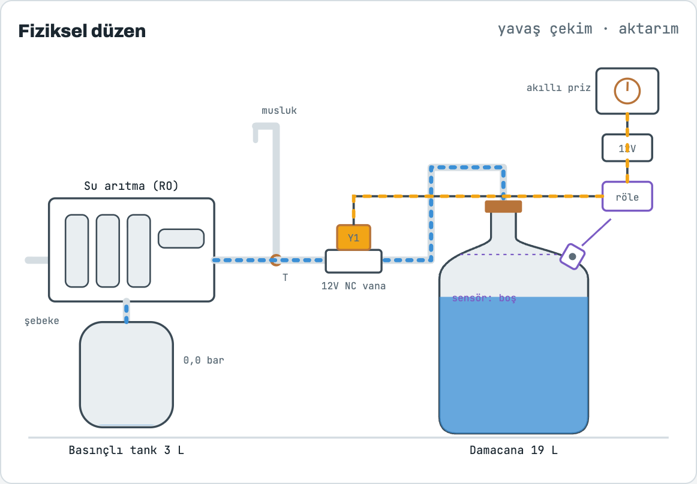

---

## 2. Hangi sürümü seçmeliyim?

- **Lehim, kod, Arduino gibi işlerle uğraşmak istemiyorsan → Akıllı priz sürümü.** Telefondan saat kurarsın, istediğin zaman elle açarsın.
- **Biraz kurcalamayı seviyorsan ve daha akıllı bir sistem istiyorsan → Arduino sürümü.** Damacana doluyken vanayı hiç açmaz, dolunca öterek haber verir, yeni damacana takılınca kendiliğinden devam eder. Akıllı prize gerek kalmaz, biraz da ucuzdur.

İki sürümde de **vana, adaptör, T rakor, hortum, sensör ve röle aynıdır.** Sadece “vanayı ne zaman açalım” kararını veren parça değişir.

---

## 3. Malzeme listesi

> Fiyatlar Ekim 2026 itibarıyla Türkiye için **tahmini** aralıklardır. Almadan önce güncel fiyatlara bak.

### Her iki sürümde ortak

| # | Parça | Nasıl bir şey almalı? | Tahmini fiyat |
|---|---|---|---|
| 1 | **Selenoid vana** | 12 V DC, **NC** (normalde kapalı), **1/4" hızlı bağlantı**, “direkt etkili” (0 bar'da açar), plastik gövde. Arama: `arıtma selenoid valf 12V 1/4` | 250–500 ₺ |
| 2 | **12 V adaptör** | 12 V DC, en az 1 A, DC jak çıkışlı | 100–200 ₺ |
| 3 | **T rakor** | 1/4" hızlı bağlantı (push-fit) T | 30–80 ₺ |
| 4 | **Arıtma hortumu** | 1/4" (dış çap 6,35 mm), 1–2 m | 40–100 ₺ |
| 5 | **Seviye sensörü** | XKC-Y25-V temassız sıvı seviye sensörü | 250–450 ₺ |
| 6 | **Röle modülü** | 12 V, 1 kanal, optokuplörlü, **H/L tetik seçmeli** (jumper'lı) | 50–120 ₺ |
| 7 | **Diyot** | 1N4007 (vananın uçlarına ters bağlanır, rölenin ömrünü uzatır) | ~5 ₺ |
| 8 | Küçük malzeme | 2 damarlı kablo, klemens, DC jak klemensi, cırt bant, küçük proje kutusu | 80–200 ₺ |

### Sadece akıllı priz sürümü

| Parça | Not | Tahmini fiyat |
|---|---|---|
| Wi-Fi akıllı priz | Zaman ayarlı, Tuya / Smart Life uyumlu herhangi bir model | 300–600 ₺ |

### Sadece Arduino sürümü

| Parça | Not | Tahmini fiyat |
|---|---|---|
| Arduino Nano (klon olur) | CH340 USB çipli, Mini-USB veya USB-C | 150–300 ₺ |
| Aktif buzzer | **5 V aktif** (pasif buzzer ses çıkarmaz) | ~15–30 ₺ |
| Buton | Küçük basmalı buton (tact switch) | ~5 ₺ |
| 10 kΩ direnç | Sensör girişi için | ~2 ₺ |
| USB veri kablosu | Kartı bilgisayara bağlamak için (şarj kablosu olmaz) | elinde vardır |

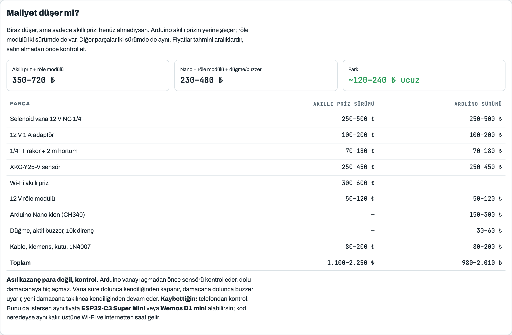

---

## 4. Gerekli aletler

- Maket bıçağı veya hortum makası (hortumu düz kesmek için)
- Küçük tornavida (klemensler için)
- Kablo soyucu veya yan keski
- Matkap ve 7–8 mm uç (damacana kapağını delmek için)
- **Arduino sürümü için:** bilgisayar (Mac veya Windows). Lehim **gerekmez**; kabloları klemensli bir Nano genişletme kartı (“Nano terminal adapter”) veya jumper kablolarla bağlayabilirsin.

---

## 5. Adım 1 – Tesisat bağlantısı

> Başlamadan önce arıtma cihazının **su girişini kapat** ve musluğu açarak tanktaki basıncı boşalt.

1. **Hortum ölçünü kontrol et.** Arıtmadan musluğa giden hortumun dış çapını ölç. **6,35 mm ise 1/4"**, 9,5 mm ise 3/8"'dir. Vana ve T rakoru bu ölçüde al. Neredeyse tüm ev tipi arıtmalar 1/4" kullanır.
2. **Hortumu kes.** Tanktan (veya son filtreden) musluğa giden hortumu, tezgah altında rahat ulaşabileceğin bir yerden **düz** kes.
3. **T rakoru tak.** Hortumun iki ucunu T'nin iki karşılıklı ağzına sonuna kadar it. Hızlı bağlantılarda hortum yaklaşık 1,5 cm içeri girer ve tık diye oturur. Çekince çıkmamalı.
4. **Vanayı bağla.** T'nin boş ağzından kısa bir hortum parçasıyla vananın **girişine** bağlan. Vana gövdesindeki **ok akış yönünü** gösterir: ok damacanaya doğru bakmalı.
5. **Damacana hortumu.** Vananın çıkışına 1–1,5 m hortum tak. Yedek bir damacana kapağını hortum çapında del, hortumu kapaktan geçir. Hortumun ucu suya değmesin, hava boşluğu kalsın.
6. Arıtmanın su girişini aç, rakorlarda **sızıntı** olup olmadığına bak. Vana şu an elektriksiz olduğu için kapalıdır, damacanaya su gitmemeli.

---

## 6. Adım 2 – Damacana sensörü

**XKC-Y25-V**, damacananın plastiğinin arkasındaki suyu dışarıdan algılar. Suya değmez, kapağı delmek gerekmez.

| Kablo rengi | Görevi | Akıllı priz sürümünde | Arduino sürümünde |
|---|---|---|---|
| Kahverengi | + besleme | Adaptör **+12 V** | Arduino **5V** pini ⚠️ |
| Mavi | − (GND) | Adaptör − | Arduino GND |
| Sarı | Çıkış (suyu görünce “yüksek” olur) | Röle modülü **IN** | Arduino **D2** |
| Siyah | Mod seçimi | Boşta bırak, ucunu bantla | Boşta bırak, ucunu bantla |

> ⚠️ **Arduino sürümünde sensörü kesinlikle 12 V'a bağlama.** 12 V ile beslenirse sarı çıkıştan 12 V gelir ve Arduino'nun D2 pinini yakar.

**Montaj:**
- Sensörü damacananın **omuz kısmına**, yaklaşık 18 litre seviyesine yerleştir. Yüzeyi plastiğe **tam otursun**, arada hava boşluğu kalmasın.
- Damacana her değiştiğinde sensörü yenisine taşıyacaksın. Bu yüzden yapıştırmak yerine **cırt bant** veya lastik kayışla bağla.
- Yanında metal veya ıslak yüzey olmasın.

**Takmadan önce test:** Sensörü bağladıktan sonra dolu bir pet şişeye bastır. Sensörün üstündeki LED yanmalı. Multimetren varsa sarı ile mavi arasında su varken besleme gerilimini, yokken ~0 V görmelisin. Ters çalışıyorsa siyah kabloyu maviye bağla.

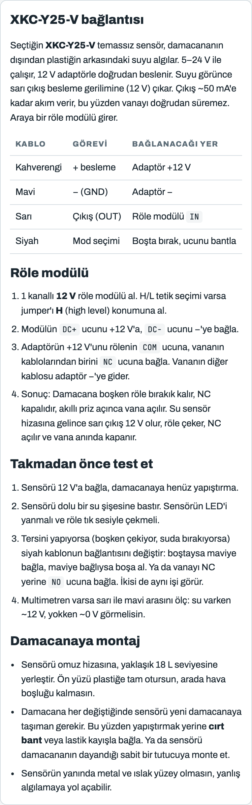

---

## 7. Adım 3A – Akıllı priz sürümü

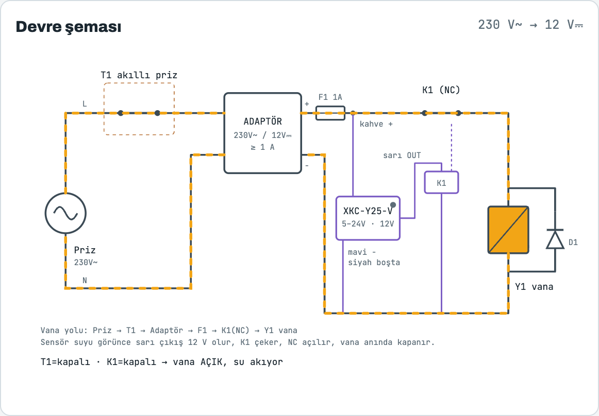

### Bağlantı

```
Duvar prizi → Akıllı priz → 12 V adaptör
                               │
                     +12 V ────┼──► Sensör kahverengi
                               ├──► Röle DC+
                               └──► Röle COM
                     −  ───────┬──► Sensör mavi
                               ├──► Röle DC−
                               └──► Vana − kablosu

Sensör sarı ─────────────────────► Röle IN   (jumper: H)
Röle NC     ─────────────────────► Vana + kablosu
1N4007      : vananın iki ucuna, çizgili taraf vana + ucuna
```

**Mantık:** Damacana boşken röle bırakıktır, **NC** kontağı kapalıdır. Akıllı priz açılınca vana elektrik alır ve açılır. Su sensör hizasına gelince sarı çıkış 12 V olur, röle çeker, NC açılır ve vana **anında** kapanır.

### Akıllı priz ayarı (Tuya / Smart Life)

1. Prizi uygulamaya ekle.
2. **Zamanlama** ekranında her aktarım için iki satır oluştur, “her gün” tekrarlansın:
   - `00:00 Aç` → `00:05 Kapat`
   - `06:00 Aç` → `06:05 Kapat`
   - `12:00 Aç` → `12:05 Kapat`
   - `18:00 Aç` → `18:05 Kapat`
3. Uygulamada **Döngü** (circulate) seçeneği varsa daha kolay: `5 dk açık, 355 dk kapalı`.
4. **Ayarlar → Güç kesintisi sonrası durum → Kapalı** yap. Bu önemli, yoksa elektrik gelince vana açılabilir.

---

## 8. Adım 3B – Arduino sürümü

Bu sürümde akıllı priz yoktur. 12 V adaptör doğrudan duvara takılır. Zamanı Arduino tutar, sensörü Arduino okur, röleyi Arduino sürer.

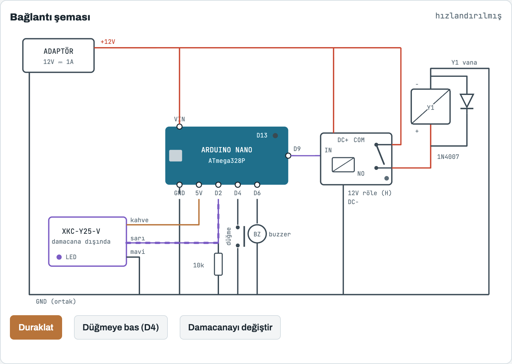

### Pin bağlantıları

| Nereden | Nereye | Not |
|---|---|---|
| Adaptör **+12 V** | Nano **VIN**, röle **DC+**, röle **COM** | Kartın tek beslemesi bu |
| Adaptör **−** | Nano **GND**, röle **DC−**, sensör **mavi**, vana **−** | Bütün GND'ler ortak |
| Sensör **kahverengi** | Nano **5V** | **12 V'a değil!** |
| Sensör **sarı** | Nano **D2** | D2 ile GND arasına **10 kΩ** direnç |
| Sensör **siyah** | — | Boşta bırak |
| Nano **D9** | Röle **IN** | Röle jumper'ı **H** konumunda |
| Röle **NO** | Vana **+** | Röle çekince vana açılır |
| 1N4007 | Vananın iki ucuna | Çizgili taraf vana **+** ucuna |
| Nano **D4** | Buton → GND | İstediğin an elle aktarım |
| Nano **D6** | Buzzer **+** (− ucu GND) | Damacana dolunca uyarır |

> Arduino sürümünde röle **NO** ucunu kullanır (akıllı priz sürümünde NC). Çünkü burada röleyi Arduino açıp kapatıyor: Arduino “aç” derse röle çeker ve vana açılır.

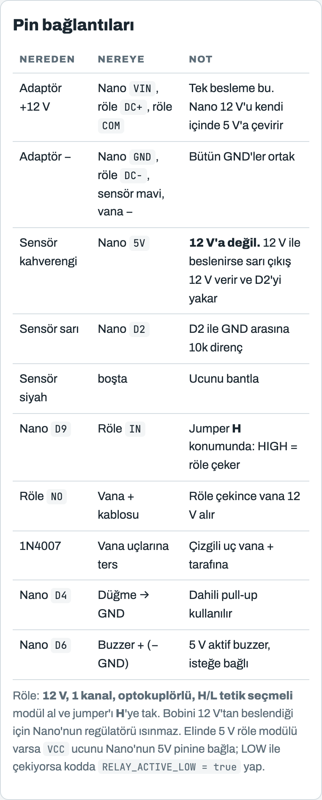

### Arduino ne yapıyor?

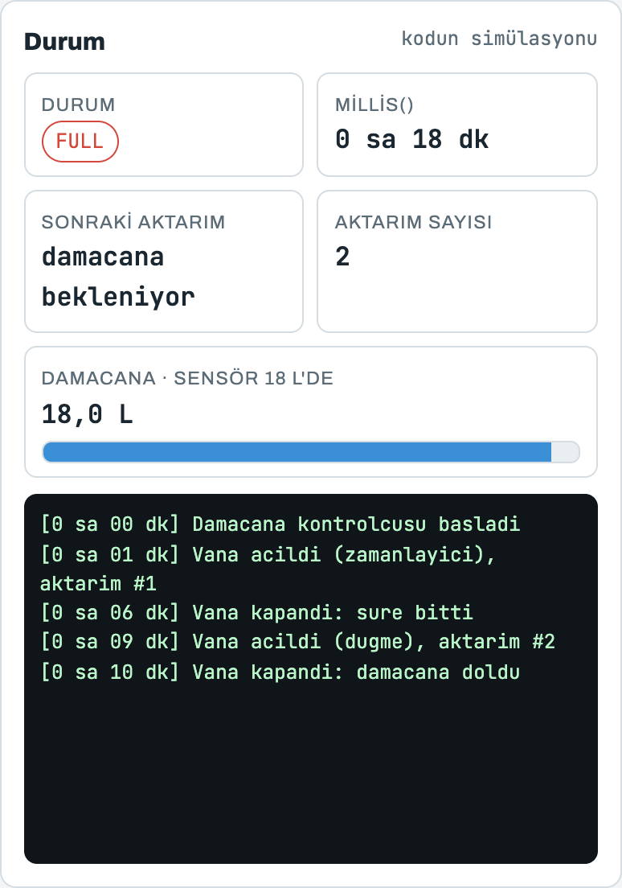

| Durum | Ne olur? |
|---|---|
| `WAITING` | Bir sonraki aktarım zamanını bekler (varsayılan 6 saat). |
| `FILLING` | Vanayı açar. 5 dakika dolunca **veya** damacana dolunca kapatır. |
| `FULL` | Damacana dolu. Vanayı açmaz, 10 dakikada bir üç kez bip yapar. Yeni damacana takılınca 1 dakika sonra aktarıma devam eder. |

- Elektrik gidip gelirse Arduino baştan başlar ve **1 dakika sonra** ilk aktarımı yapar.
- Butona basınca beklemeden aktarım başlar; vana açıkken basınca kapanır.

### Buzzer ne işe yarar?

Damacana dolunca sistem durur ve sen değiştirene kadar bekler. Buzzer bunu sana **“damacana doldu, değiştir”** diye haber verir. Buzzersız da sistem güvenle çalışır, sadece dolduğunu kendin fark etmen gerekir. Gece rahatsız ederse kodda `BUZZER_ENABLED = false` yap veya D6'ya 220 Ω dirençle bir LED bağla.

---

## 9. Arduino'yu Mac'e bağlama ve kodu yükleme

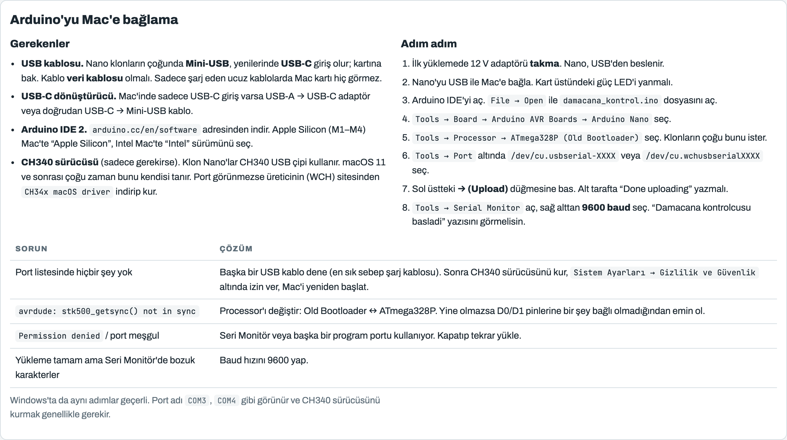

### Gerekenler

- **USB veri kablosu.** Nano klonların çoğunda **Mini-USB**, yenilerinde **USB-C** giriş olur. Kablo mutlaka **veri** taşımalı. Sadece şarj eden kablolarda Mac kartı hiç görmez (en sık yaşanan sorun budur).
- **USB-C dönüştürücü.** Mac'inde sadece USB-C giriş varsa USB-A → USB-C adaptör veya doğrudan USB-C → Mini-USB kablo.
- **Arduino IDE 2.** [arduino.cc/en/software](https://www.arduino.cc/en/software) adresinden indir. Apple Silicon (M1/M2/M3/M4) Mac için “Apple Silicon”, eski Intel Mac için “Intel” sürümünü seç. İndirilen dosyayı aç ve uygulamayı **Uygulamalar** klasörüne sürükle.
- **CH340 sürücüsü (sadece gerekirse).** Klon Nano'lar CH340 USB çipi kullanır. macOS 11 ve sonrası çoğu zaman bunu kendisi tanır. Port görünmezse üreticinin (WCH) sitesinden `CH34x macOS driver` indirip kur.

### Kodu yükleme

1. **İlk yüklemede 12 V adaptörü takma.** Nano, USB'den beslenir.
2. Nano'yu USB ile Mac'e bağla. Kart üzerindeki güç LED'i yanmalı.
3. Arduino IDE'yi aç. `File → Open` ile bu depodaki [`damacana_kontrol/damacana_kontrol.ino`](damacana_kontrol/damacana_kontrol.ino) dosyasını aç.
4. `Tools → Board → Arduino AVR Boards → Arduino Nano` seç.
5. `Tools → Processor → ATmega328P (Old Bootloader)` seç. Klonların çoğu bunu ister; yükleme hata verirse `ATmega328P` dene.
6. `Tools → Port` altında `/dev/cu.usbserial-XXXX` veya `/dev/cu.wchusbserialXXXX` gibi bir port seç.
7. Sol üstteki **→ (Upload)** düğmesine bas. Altta **“Done uploading”** yazmalı.
8. `Tools → Serial Monitor` aç, sağ alttan **9600 baud** seç. `Damacana kontrolcusu basladi` yazısını görmelisin.

> **Windows'ta** da adımlar aynı. Port adı `COM3`, `COM4` gibi görünür ve genelde CH340 sürücüsünü kurmak gerekir.

### Kodda değiştirebileceğin ayarlar

Dosyanın başındaki şu satırları değiştirip tekrar yüklemen yeterli:

| Ayar | Varsayılan | Ne işe yarar? |
|---|---|---|
| `INTERVAL_MS` | 6 saat | İki aktarım arası süre |
| `OPEN_MS` | 5 dk | Vananın açık kalma süresi |
| `FIRST_RUN_MS` | 1 dk | Açılıştan sonra ilk aktarım |
| `BEEP_EVERY_MS` | 10 dk | Damacana doluyken uyarı aralığı |
| `SENSOR_ACTIVE_HIGH` | `true` | Sensör ters çalışırsa `false` |
| `RELAY_ACTIVE_LOW` | `false` | Rölen LOW ile çekiyorsa `true` (çoğu 5 V modül) |
| `BUZZER_ENABLED` | `true` | Buzzer'ı kapatmak için `false` |

---

## 10. Ayarlar: günde kaç kez aktarım?

Arıtmanın tankı dolunca cihaz kendiliğinden durur, yani **tank taşmaz**. En verimli ayar: **aktarım aralığı ≈ tankın 3 litreyi doldurma süresi.** Böylece her aktarımda tam 3 litre gider.

| Tank kaç saatte doluyor? | Aktarım aralığı | Günde | Damacanaya / gün | Damacana dolma süresi |
|---|---|---|---|---|
| 1 saat | 1 saatte bir | 24 | 72 L | ~6 saat |
| 2 saat | 2 saatte bir | 12 | 36 L | ~12 saat |
| 3 saat | 3 saatte bir | 8 | 24 L | ~18 saat |
| 5 saat | 6 saatte bir | 4 | 12 L | ~1,5 gün |
| 8 saat | 8 saatte bir | 3 | 9 L | ~2 gün |

**Kendi tankının dolma süresini ölç:** Tankı musluktan tamamen boşalt, musluğu kapat ve arıtmadan gelen su sesi kesilene kadar geçen süreyi tut.

**Vana neden 5 dakika açık?** Dolu tankta basınç ~2–3 bar, boşalırken ~0,3 bar'a düşer. 1/4" hatta ortalama debi dakikada ~1 litre olduğu için 3 litre yaklaşık 3 dakikada akar. Üstüne pay eklenir. Uzun tutmanın zararı yok.

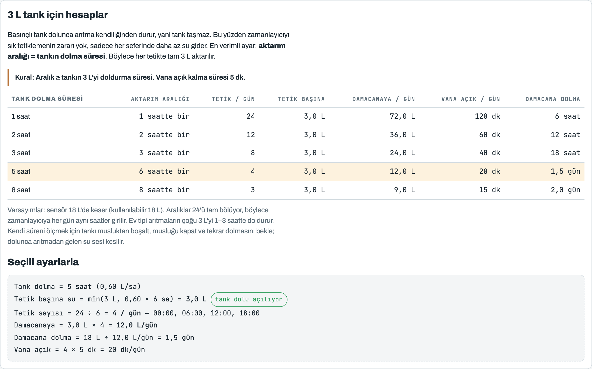

---

## 11. İlk çalıştırma ve test

1. **Vanayı test et:** Akıllı prizi uygulamadan aç veya Arduino'daki butona bas. Röle tık sesi çıkarmalı, vana açılmalı ve damacanaya su akmalı.
2. **Sensörü test et:** Vana açıkken sensörü dolu bir şişeye bastır. Vana **hemen** kapanmalı. Arduino sürümünde buzzer üç kez bip yapmalı.
3. **Arduino'da kısa test:** Koddaki süreleri geçici olarak kısalt (`INTERVAL_MS = 2UL * 60 * 1000`, `OPEN_MS = 20UL * 1000`), yükle ve Seri Monitör'den izle. Test bitince gerçek değerleri geri yaz ve tekrar yükle.
4. **İlk gün:** Birkaç aktarımı gözünle izle. Rakorlarda damlama olmamalı, damacana sensör hizasında durmalı.

---

## 12. Sorun giderme

| Sorun | Muhtemel sebep | Çözüm |
|---|---|---|
| Vana hiç açılmıyor | Adaptör takılı değil / röle bağlantısı ters | Röle LED'ini kontrol et. Akıllı priz sürümünde NC, Arduino sürümünde NO kullanılmalı |
| Vana açılıyor ama su çok az akıyor | Pilot kumandalı vana alınmış | “Direkt etkili”, 0 bar'da açan vana kullan |
| Vana sürekli açık, sensör dolu deyince kapanıyor (veya tersi) | Sensör/röle mantığı ters | Siyah kabloyu maviye bağla, ya da kodda `SENSOR_ACTIVE_HIGH` / `RELAY_ACTIVE_LOW` değiştir |
| Arduino açılır açılmaz röle çekiyor | Röle LOW ile tetikleniyor | Jumper'ı **H**'ye al veya `RELAY_ACTIVE_LOW = true` |
| Mac'te port görünmüyor | Şarj kablosu / sürücü | Veri kablosu dene, CH340 sürücüsünü kur, Mac'i yeniden başlat |
| `avrdude: stk500_getsync() not in sync` | Yanlış işlemci seçimi | `Old Bootloader` ↔ `ATmega328P` arasında değiştir |
| Sensör boşken de “dolu” diyor | Metal, ıslak yüzey veya kötü temas | Sensörü kurula, plastiğe tam otur, metal eşyalardan uzaklaştır |
| Musluktan su zayıf geliyor | Aktarım yeni yapılmış, tank boş | Aktarımları musluğu az kullandığın saatlere koy |

---

## 13. Güvenlik

- **Su hattına sadece 12 V kablo insin.** 230 V'luk vana kullanma. Akıllı prizi ve adaptörü tezgah altındaki ıslak alandan uzak, yüksek bir prize tak.
- Arduino ve rölenin bağlantılarını kapalı bir **proje kutusu** içine koy.
- İlk günlerde damacananın altına bir **tepsi** koy. Vana açık takılıp sensör de arızalanırsa su taşabilir.
- Su içilecekse vana, hortum ve rakorların **gıdaya uygun** olmasına dikkat et.

---

## 14. Dosyalar

```
.
├── README.md                          ← bu dosya
├── damacana_kontrol/
│   └── damacana_kontrol.ino           ← Arduino kodu
└── docs/
    ├── index.html                     ← animasyonlu tasarım sayfası (iki sürüm, sekmeli)
    ├── arduino.html                   ← sadece Arduino sürümü
    └── img/                           ← README ekran görüntüleri
```

`docs/index.html` tek başına çalışan bir sayfadır: indirip çift tıklaman yeterli. Depo ayarlarından **GitHub Pages**'i `main` dalı ve `/docs` klasörüyle açarsan sayfa `https://yctatli.github.io/ro-to-bottle/` adresinde de yayınlanır.

---

## Lisans

[MIT](LICENSE). Dilediğin gibi kullan, değiştir, paylaş.
